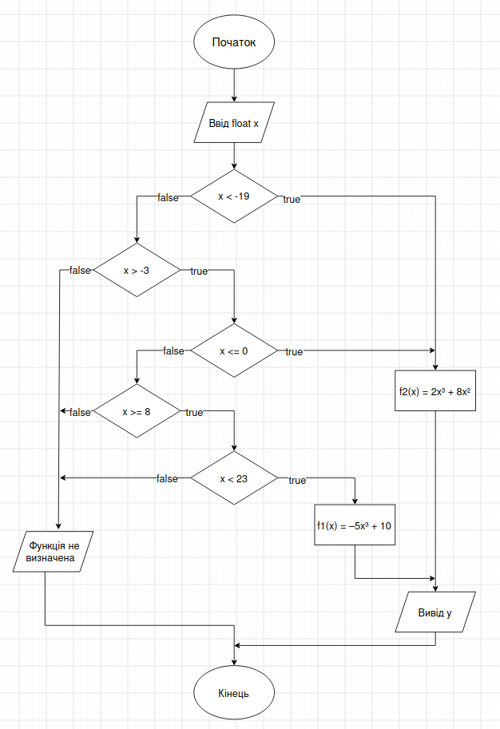
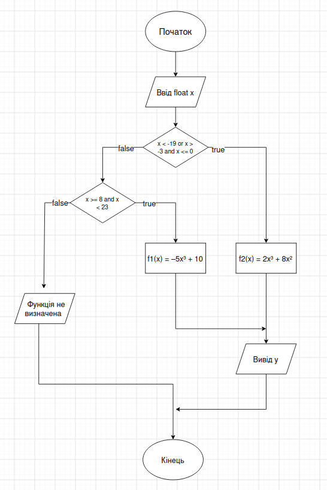
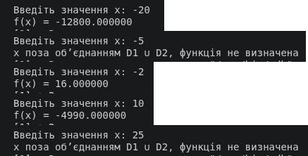

# Лабораторна робота № 1

## Розгалужені алгоритми

**Дисципліна:** Структури даних та алгоритми (СДА)\
**Мова програмування:** С 

### Виконав

Студент групи: ІО-65\
Солопака Святослав Сергійович\
Номер у списку групи: 20

### Перевірив

Русінов Володимир Володимирович

## 1. Мета 

Метою лабораторної роботи «Розгалужені алгоритми» є засвоєння теоретичного матеріалу та набуття практичних навичок використання керуючих конструкцій розгалуження та булевих (логічних) операцій.

## 2. Задача

Задано дійсне число x. Визначити значення заданої за варіантом кусково-неперервної функції y(x), якщо воно існує, або вивести на екран повідомлення про неіснування функції для заданого x.

Розв'язати задачу **двома способами** (написати дві програми):

1. У програмі дозволяється використовувати тільки одиничні операції порівняння (`=`, `<>`, `<`, `<=`, `>`, `>=`) і **не дозволяється** використовувати булеві (логічні) операції (`not`, `and`, `or` тощо);
2. У програмі необхідно **обов'язково** використати булеві (логічні) операції (`not`, `and`, `or` тощо); використання булевих операцій не повинно бути надлишковим.

### Завдання для варіанту 20

Для заданого дійсного x обчислити:

```
         f1(x) ,  x ∈ D1
y(x) =
         f2(x) ,  x ∈ D2
```

(для x поза об'єднанням D1 ∪ D2 функція не визначена — програма повинна вивести відповідне повідомлення).

| Варіант       | f1(x), x ∈ D1          | f2(x), x ∈ D2                      |
| ------------- | --------------------- | ----------------------------------|
| 10, 20, 30    | –5x³ + 10, x ∈ [8,23) | 2x³ + 8x², x ∈ (–∞, –19) ∪ (–3,0] |

## 3. Блок-схеми

### Cпосіб 1



### Cпосіб 2



## 4. Тестування

Код знаходиться в репозиторії.

| №   | Програма | Вхідне значення (x) | Очікуваний результат / Виведення                 |
| --- | :------- | :-----------------: | :----------------------------------------------- |
| 1   | ./Solution1   |         -20         | f(x) = -12800                               |
| 2   | ./Solution1   |         -5          | x поза об’єднанням D1 u D2, функція не визначена |
| 3   | ./Solution1   |         -2          | f(x) = 16                         |
| 4   | ./Solution1   |         10          | f(x) = -4990                         |
| 5   | ./Solution1   |         25          | x поза об’єднанням D1 u D2, функція не визначена |
| 6   | ./Solution2   |         -20         | f(x) = -12800                            |
| 7   | ./Solution2   |         -5          | x поза об’єднанням D1 u D2, функція не визначена |
| 8   | ./Solution2   |         -2          | f(x) = 16                            |
| 9   | ./Solution2   |         10          | f(x) = -4990                             |
| 10  | ./Solution2   |         25          | x поза об’єднанням D1 u D2, функція не визначена  |

### Спосіб 1


### Спосіб 2



### 5. Висновок

В ході виконання лабораторної роботи №1 я застосував на практиці знання отримані з лекцій, і краще зрозумів принцип роботи алгоритмів.
