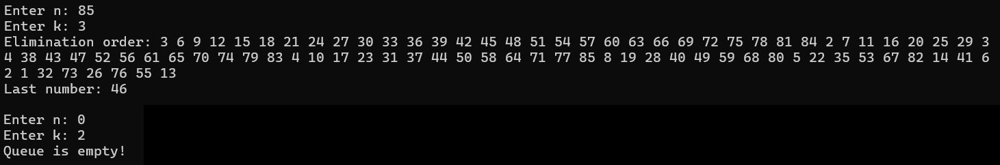
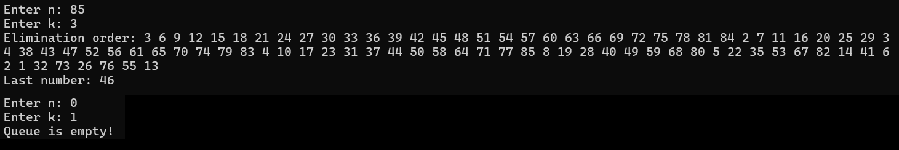

Національний технічний університет України "Київський політехнічний інститут ім. І. Сікорського"
Факультет інформатики та обчислювальної техніки

Алгоритми та структури даних

Виконав студент групи: ІО-65 Солопака Святослав

Номер у списку групи: 20

Перевірив: Русінов Володимир Володимирович

# Лабораторна робота №3. Стеки та черги

## Мета лабораторної роботи

Засвоєння теоретичного матеріалу та набуття практичних навичок реалізації й застосування абстрактних структур даних стек (LIFO — «останнім прийшов, першим вийшов») та черга (FIFO — «першим прийшов, першим вийшов»), а також порівняння двох способів їхньої реалізації — на основі масиву фіксованого розміру та на основі однозв'язного списку.

## Завдання лабораторної роботи

Вирішити задачу Йосифа Флавія двома способами: використовуючи одновимірний масив, та однозв'язний список. Написати дві програми, що реалізують вирішення задачі. Створити дві структури черги - одну працюючу через масив, іншу через список.

## Код

Присутній в репозиторії.

## Світлини результатів виконання програми

* Тестування програми

## Висновки

Отже, в ході виконання лабораторної роботи були використані дві реалізації черги - за масивом та за однозв'язним списком. Головною різницею між цими реалізаціями є обмеження в пам'яті. У першої реалізації(масиву) використання пам'яті обмежене, в той час як у другої - не обмежене. Реалізація черги через масив легша в розумінні, але при малих значеннях n може забирати забагато пам'яті, а при занадто великих - взагалі переставати працювати. З цього можна зробити висновок, що при значеннях n, далеких від 100(приклад для цієї лабораторної), доцільніше використовувати реалізацію через однозв'язний список. Для перевірки на пустоту черги, перша реалізація перевіряє кількість записаних в ній елементів, в той час як друга перевіряє існування першого елементу.

